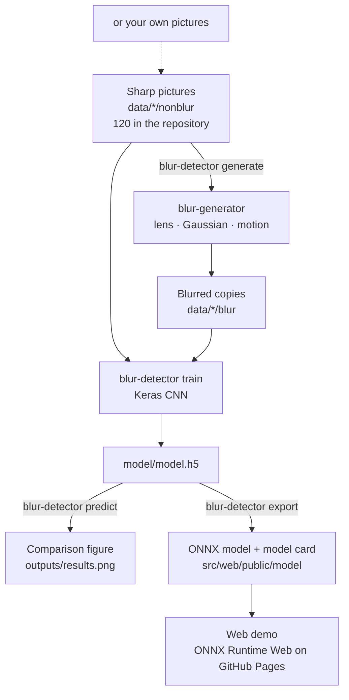
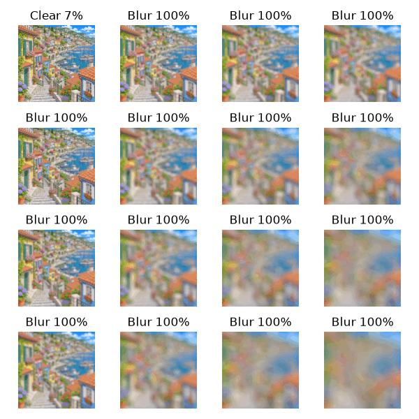

<p align="center">
  <picture>
    <source media="(prefers-color-scheme: dark)" srcset="https://raw.githubusercontent.com/NatLee/simply-blur-detector/main/docs/images/hero-dark.png">
    
  </picture>
</p>

<p align="center">
  <a href="https://natlee.github.io/simply-blur-detector/"></a>
  <a href="https://github.com/NatLee/simply-blur-detector/actions/workflows/ci.yml"></a>
  <a href="https://github.com/NatLee/simply-blur-detector/actions/workflows/pages.yml"></a>
  
  
  
  <a href="LICENSE"></a>
</p>

A small convolutional neural network (CNN) that tells sharp pictures from blurry ones. You train it on a
folder of sharp pictures: [blur-generator](https://github.com/NatLee/blur-generator) makes a lens,
Gaussian or motion-blurred copy of each one, and the network learns the difference. The repository
comes with 120 illustrations of its own and their blurred copies, ready to train on, or you can bring
your own pictures. Everything runs in Docker on x86 and ARM machines, and the trained model is also
published as a
**[web demo](https://natlee.github.io/simply-blur-detector/)**: drop a picture and it shows the
network's verdict, a window-by-window blur heat map and the classic Laplacian variance side by side,
all in your browser.

<p align="center">
  <picture>
    <source media="(prefers-color-scheme: dark)" srcset="https://raw.githubusercontent.com/NatLee/simply-blur-detector/main/docs/images/demo-dark.png">
    
  </picture>
</p>

## How it works



Every picture is prepared the same way for training, prediction and the web demo: each colour
channel's histogram is equalized, the picture is resized to 256 × 256 and scaled to 0–1. The network is
three convolution + max-pooling blocks and two dense layers (about 100k weights); it answers with the
probability of "Clear" and "Blur".

## Quick start

You need [Docker](https://docs.docker.com/get-docker/) with Compose. The same image builds on x86-64
and on ARM64 (Apple silicon included).

```bash
git clone https://github.com/NatLee/simply-blur-detector.git
cd simply-blur-detector
docker compose up
```

`docker compose up` trains the network on the pictures in `data/` ([what they are](data/README.md)) for
5 epochs, saves it to `model/model.h5` and draws `outputs/results.png`. If `model/model.h5` already
exists, training continues from it. Five epochs is a quick first run; the web demo's model trains for
longer and with crops, see [The web demo](#the-web-demo). To run every step from scratch (new blurred
copies, a new model, the figure and the web demo's model):

```bash
./scripts/fast-run.sh        # Windows: scripts\fast-run.bat
```

## Commands

Inside the container the command line is `blur-detector`; with Compose, put
`docker compose run --rm detector` in front. `blur-detector <command> --help` lists every flag.

| Command | What it does |
|---|---|
| `draw` | Draws a data set of cartoon scenes from code, which needs nothing but the package (the tests use it): 60 training and 20 test scenes plus a `demo.png`. Give it a folder of its own, such as `--data_path=/data/drawn`; `--seed` picks other scenes, `--train` / `--test` change the counts. |
| `generate` | Writes a blurred copy of every picture in `data/{train,test}/nonblur` to the `blur` folder next to it: a lens, Gaussian or motion blur of random strength (`--seed` makes it repeatable; the copies in the repository are `--seed=1`). |
| `train` | Trains on `data/{train,test}/{blur,nonblur}` and saves `model/model.h5`. `--epochs` (5), `--crops=N` (also train on N random crops of every picture, for the heat map), `--seed`, `--model_path=None` to start over. |
| `predict` | Prints P(blur) of one picture, then blurs it more and more and draws a 4 × 4 grid of predictions. `--img_path`, `--blur_mode` (`lens`, `gaussian`, `motion`), `--save_fig_path`. |
| `export` | Exports the model for the web demo: an ONNX file checked against Keras, and a model card with the accuracy and package versions. |
| `run` | Trains, saves and draws the figure in one go: the default command, with the same flags as the old `main.py` (`--train_model`, `--save_model`, `--demo`, `--demo_img_path`, `--demo_blur_mode`, ...). |

Paths are inside the container, where Compose mounts `./data` on `/data`, `./model` on `/model`,
`./outputs` on `/outputs` (the working folder) and `src/web/public` on `/web`. In Git Bash on Windows,
put `MSYS_NO_PATHCONV=1` in front of commands with such paths, otherwise Git Bash turns `/web/...` into
a Windows path (PowerShell and cmd leave them alone).

For example, ask the model about the demo picture (`data/demo.png`, a hillside harbour town, the same
picture as the web demo's Harbour town):

```console
$ docker compose run --rm detector predict --img_path=/data/demo.png --blur_mode=lens --save_fig_path=/outputs/demo-lens.png
INFO | Blur Detection Model Loaded.
INFO | /data/demo.png: Clear (P(blur) = 0.001)
INFO | tile 0,0: Clear (P(blur) = 0.068)
...
INFO | Saved the comparison figure to /outputs/demo-lens.png
0.0005603581666946411
```

The last line is the return value, P(blur), so a script can use it (log lines shortened here).

<p align="center">
  
</p>

## Train on your own pictures

Put sharp pictures (`.png`, `.jpg`, `.jpeg`) in `data/train/nonblur` and `data/test/nonblur` (next to the
repository's pictures, or instead of them), then let blur-generator make the blurry half and train:

```text
data
├── train
│   ├── nonblur   your sharp pictures
│   └── blur      written by `generate`
└── test
    ├── nonblur
    └── blur
```

```bash
docker compose run --rm detector generate
docker compose run --rm detector train --model_path=None --epochs=20 --crops=2
docker compose run --rm detector export
```

Training reads only the pictures directly in those four folders, so `data/demo.png` (the default picture
of `run` and `predict`), `data/pictures.json`, `data/README.md` and other folders can sit next to them.

## Use it from Python

```python
from blur_detection import DetectionModel, get_data, prepare_image, predict_blur_img
from blur_detection.images import read_image

detector = DetectionModel()                      # untrained; DetectionModel('/model/model.h5') loads one
train_ds, test_ds = get_data('/data')            # tf.data datasets of prepared pictures
detector.train(train_ds, test_ds, epochs=5)
detector.save('/model/model.h5')                 # .h5 or .keras

probabilities, labels = detector.predict(prepare_image(read_image('/data/demo.png')))
print(labels[0], float(probabilities[0][1]))     # e.g. "Clear 2.49e-05" after this short training

predict_blur_img(detector, '/data/demo.png', blur_mode='lens', save_fig_path='/outputs/results.png')
```

`DetectionModel` also loads `.h5` weight files saved by the original TensorFlow 2.7 version of this
project.

## The web demo

The demo runs the same network with [ONNX Runtime Web](https://onnxruntime.ai/docs/tutorials/web/), so
your pictures never leave the browser. It opens with one of its five sample pictures, or the one a
`#sample=<file>` link names, and shows:

- the CNN's P(blur) for the whole picture, and the Laplacian variance (a blur score that needs no
  training: low variance means few sharp edges) with an adjustable threshold;
- a heat map from either detector over square windows half as wide as the picture's shorter side
  (the smallest crop the network saw in training);
- a stress test that blurs the picture step by step and plots how both scores react.

The sample pictures are in [`src/web/public/samples`](src/web/public/samples), listed in
`samples.json`; they are not among the training pictures. When that list cannot be read, the page says
so and asks you to drop, paste or choose a picture of your own; the detectors, the heat map and the
stress test all work with it.

GitHub Actions builds it ([`pages.yml`](.github/workflows/pages.yml)): it trains the network on the
pictures in `data/` (EPOCHS, CROPS and SEED at the top of the workflow), exports it, refuses to publish a
model that gets fewer than 85% of the test pictures right, checks in Node.js that the page's JavaScript
gives the same P(blur) as Python for `data/demo.png`, runs the page in Chrome, and deploys
`src/web/public`. The model card at the bottom of the page links to the run that trained it.

The 85% threshold (`PUBLISH_MIN_TEST_ACCURACY` in
[`config.py`](src/detector/blur_detection/config.py), counted in whole pictures: 34 of 40) was 90% until
the project owner lowered it on 2026-11-04, for the anime pictures the model was trained on then. The
model trained on the pictures in the repository now clears it easily (39 of 40 in a local run).

To try the page on your own machine, export a model and serve the folder:

```bash
docker compose run --rm detector export
docker compose run --rm -p 8000:8000 --entrypoint python detector -m http.server 8000 -d /web
# open http://localhost:8000
```

## GPU

On a Linux machine with an NVIDIA GPU and the
[NVIDIA Container Toolkit](https://docs.nvidia.com/datacenter/cloud-native/container-toolkit/), the
`detector-gpu` service builds the image with TensorFlow's CUDA libraries and hands the GPU to it:

```bash
docker compose run --rm detector-gpu train
```

## Development

```bash
pip install -e "src/detector[test]"      # Python 3.10-3.13
cd src/detector && pytest                # data, model, figure, command line, ONNX export
cd src/web && npm ci && npm test         # OpenCV ports, heat map, browser pipeline (needs an exported model)
```

Or in Docker: `docker build --build-arg EXTRAS=test -t simply-blur-detector:test .`, then run
`pytest` in it with `src` mounted. CI runs both suites, and builds and runs the Docker image on amd64
and arm64.

The project is laid out as `src/detector` (the Python package `blur_detection` and its tests) and
`src/web` (the demo page in `public/`, its tests and the tool that makes its OpenCV test fixture).

## The training pictures

The training pictures are 120 of this project's own illustrations, drawn in an anime style: people,
landscapes, rooms, food, animals, towns, machines, plants and night scenes, from thick outlines with flat
colours to very fine line work. 100 are for training and 20 for testing, each with a blurred copy.
[`data/README.md`](data/README.md) explains the folder, and `data/pictures.json` lists every picture
of the project (these, the demo picture, the web demo's five and the cover) with its size and checksum.

How models trained on each data set do on the test pictures (40 each: 20 sharp, 20 blurred), with the
web demo's settings:

| Model trained on | Its own test pictures | This repository's test pictures |
|---|---|---|
| these pictures | 39 / 40, windows 94.7% | (the same) |
| anime pictures from Danbooru (the published model of 2026-11-04) | 35 / 40, windows 92.1% | 35 / 40, windows 98.8% |
| cartoon scenes drawn by code (`draw`) | 40 / 40, windows 86.2% | 34 / 40, windows 68.3% |

History: until November 2026 the folder held character art from *Blue Archive* (licence unclear), then
cartoon scenes drawn by code (`blur-detector draw` still makes those), then a list of anime pictures
from Danbooru that a `fetch` command downloaded.

## License

[MIT](LICENSE) © 2023 Nat Lee, for the code and for the pictures: the training and test pictures, the
web demo's samples, the demo picture, the cover and the screenshots.

## Author

Nat Lee
