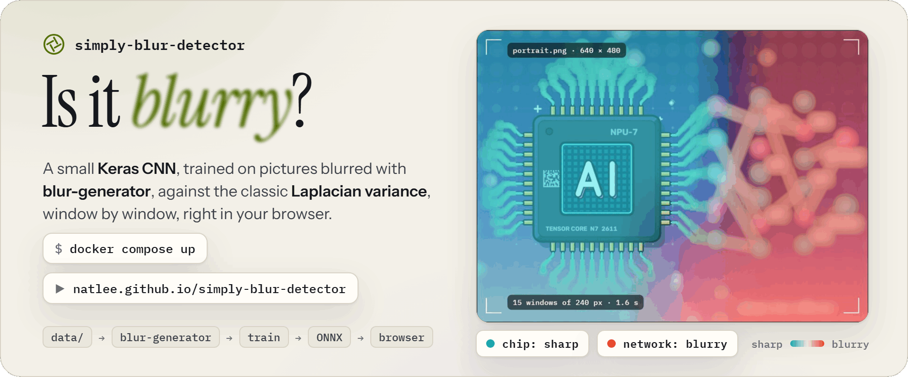
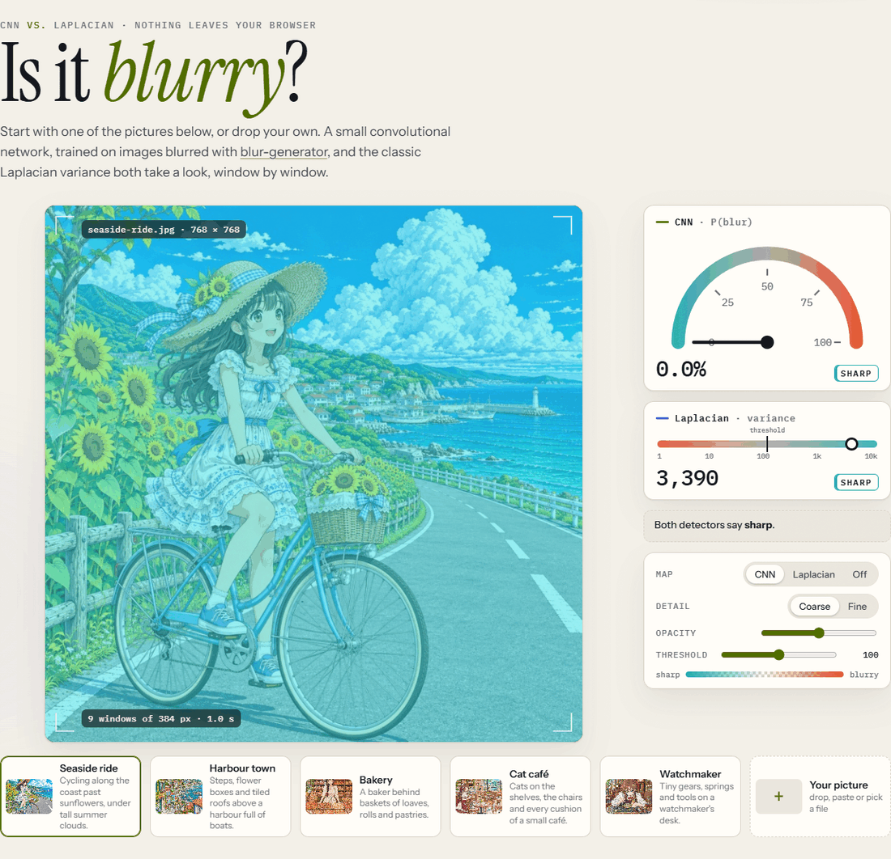
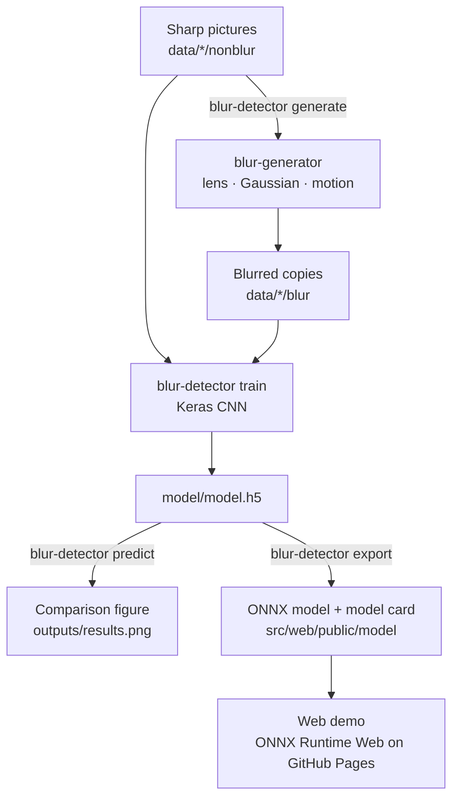
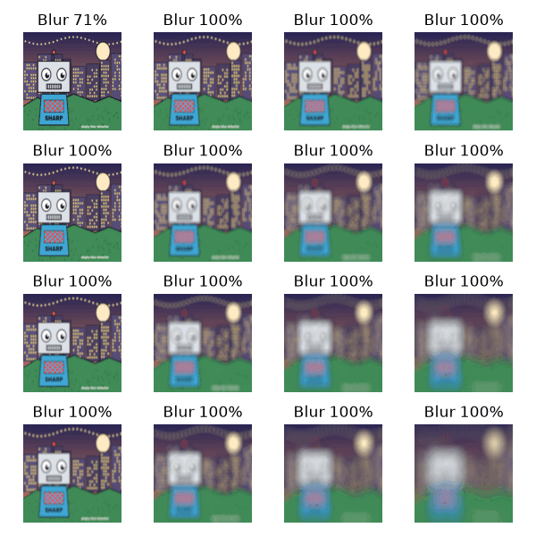

<p align="center">
  <picture>
    <source media="(prefers-color-scheme: dark)" srcset="https://raw.githubusercontent.com/NatLee/simply-blur-detector/main/docs/images/hero-dark.png">
    
  </picture>
</p>

<p align="center">
  <a href="https://natlee.github.io/simply-blur-detector/"></a>
  <a href="https://github.com/NatLee/simply-blur-detector/actions/workflows/ci.yml"></a>
  <a href="https://github.com/NatLee/simply-blur-detector/actions/workflows/pages.yml"></a>
  
  
  
</p>

A small convolutional neural network (CNN) that tells sharp pictures from blurry ones. You train it on a
folder of sharp pictures: [blur-generator](https://github.com/NatLee/blur-generator) makes a lens,
Gaussian or motion-blurred copy of each one, and the network learns the difference. Everything runs
in Docker on x86 and ARM machines, and the trained model is also published as a
**[web demo](https://natlee.github.io/simply-blur-detector/)**: drop a picture and it shows the
network's verdict, a window-by-window blur heat map and the classic Laplacian variance side by side,
all in your browser.

<p align="center">
  <picture>
    <source media="(prefers-color-scheme: dark)" srcset="https://raw.githubusercontent.com/NatLee/simply-blur-detector/main/docs/images/demo-dark.png">
    
  </picture>
</p>

## How it works



Every picture is prepared the same way for training, prediction and the web demo: each colour
channel's histogram is equalized, the picture is resized to 256 × 256 and scaled to 0–1. The network is
three convolution + max-pooling blocks and two dense layers (about 100k weights); it answers with the
probability of "Clear" and "Blur".

## Quick start

You need [Docker](https://docs.docker.com/get-docker/) with Compose. The same image builds on x86-64
and on ARM64 (Apple silicon included).

```bash
git clone https://github.com/NatLee/simply-blur-detector.git
cd simply-blur-detector
docker compose up
```

That trains the network on `data/` for 5 epochs, saves it to `model/model.h5` and draws
`outputs/results.png`. If `model/model.h5` already exists, training continues from it. To run every step
from scratch (new blurred copies, a new model, the figure and the web demo's model):

```bash
./scripts/fast-run.sh        # Windows: scripts\fast-run.bat
```

## Commands

Inside the container the command line is `blur-detector`; with Compose, put
`docker compose run --rm detector` in front. `blur-detector <command> --help` lists every flag.

| Command | What it does |
|---|---|
| `generate` | Writes a blurred copy of every picture in `data/*/nonblur` to the `blur` folder next to it: a lens, Gaussian or motion blur of random strength (`--seed` makes it repeatable). |
| `train` | Trains on `data/{train,test}/{blur,nonblur}` and saves `model/model.h5`. `--epochs` (5), `--crops=N` (also train on N random crops of every picture, for the heat map), `--seed`, `--model_path=None` to start over. |
| `predict` | Prints P(blur) of one picture, then blurs it more and more and draws a 4 × 4 grid of predictions. `--img_path`, `--blur_mode` (`lens`, `gaussian`, `motion`), `--save_fig_path`. |
| `export` | Exports the model for the web demo: an ONNX file checked against Keras, and a model card with the accuracy and package versions. |
| `run` | Trains, saves and draws the figure in one go: the default command, with the same flags as the old `main.py` (`--train_model`, `--save_model`, `--demo`, `--demo_img_path`, `--demo_blur_mode`, ...). |

Paths are inside the container, where Compose mounts `./data` on `/data`, `./model` on `/model`,
`./outputs` on `/outputs` (the working folder) and `src/web/public` on `/web`. In Git Bash on Windows,
put `MSYS_NO_PATHCONV=1` in front of commands with such paths, otherwise Git Bash turns `/web/...` into
a Windows path (PowerShell and cmd leave them alone).

For example, ask the model about one of the web demo's sample pictures:

```console
$ docker compose run --rm detector predict --img_path=/web/samples/sharp.png --blur_mode=lens --save_fig_path=/outputs/sharp-lens.png
INFO | Blur Detection Model Loaded.
INFO | /web/samples/sharp.png: Clear (P(blur) = 0.000)
INFO | tile 0,0: Clear (P(blur) = 0.000)
...
INFO | Saved the comparison figure to /outputs/sharp-lens.png
3.434520840528421e-05
```

The last line is the return value, P(blur), so a script can use it (log lines shortened here).

<p align="center">
  
</p>

## Train on your own pictures

Put sharp pictures (`.png`, `.jpg`, `.jpeg`) in `data/train/nonblur` and `data/test/nonblur`, then let
blur-generator make the blurry half and train:

```text
data
├── train
│   ├── nonblur   your sharp pictures
│   └── blur      written by `generate`
└── test
    ├── nonblur
    └── blur
```

```bash
docker compose run --rm detector generate
docker compose run --rm detector train --model_path=None --epochs=20 --crops=2
docker compose run --rm detector export
```

Files elsewhere under `data/` are ignored, so a demo picture such as `data/Mika.png` can sit next to
the folders.

## Use it from Python

```python
from blur_detection import DetectionModel, get_data, prepare_image, predict_blur_img
from blur_detection.images import read_image

detector = DetectionModel()                      # untrained; DetectionModel('/model/model.h5') loads one
train_ds, test_ds = get_data('/data')            # tf.data datasets of prepared pictures
detector.train(train_ds, test_ds, epochs=5)
detector.save('/model/model.h5')                 # .h5 or .keras

probabilities, labels = detector.predict(prepare_image(read_image('/data/Mika.png')))
print(labels[0], float(probabilities[0][1]))     # e.g. "Clear 0.327" after this short training

predict_blur_img(detector, '/data/Mika.png', blur_mode='lens', save_fig_path='/outputs/results.png')
```

`DetectionModel` also loads `.h5` weight files saved by the original TensorFlow 2.7 version of this
project.

## The web demo

The demo runs the same network with [ONNX Runtime Web](https://onnxruntime.ai/docs/tutorials/web/), so
pictures never leave the browser. It shows:

- the CNN's P(blur) for the whole picture, and the Laplacian variance (a blur score that needs no
  training: low variance means few sharp edges) with an adjustable threshold;
- a heat map from either detector over square windows half as wide as the picture's shorter side
  (the smallest crop the network saw in training);
- a stress test that blurs the picture step by step and plots how both scores react.

GitHub Actions builds it ([`pages.yml`](.github/workflows/pages.yml)): it trains the network on `data/`
(20 epochs, 2 crops per picture, seed 1), refuses to publish a model below 90% test accuracy, exports it,
checks in Node.js that the page's JavaScript gives the same P(blur) as Python for every sample, and
deploys `src/web/public`. The model card at the bottom of the page links to the run that trained it.
The sample pictures are drawn by [`src/web/tools/make_samples.py`](src/web/tools/make_samples.py), so they
contain no third-party artwork.

To try the page on your own machine, export a model and serve the folder:

```bash
docker compose run --rm detector export
docker compose run --rm -p 8000:8000 --entrypoint python detector -m http.server 8000 -d /web
# open http://localhost:8000
```

## GPU

On a Linux machine with an NVIDIA GPU and the
[NVIDIA Container Toolkit](https://docs.nvidia.com/datacenter/cloud-native/container-toolkit/), the
`detector-gpu` service builds the image with TensorFlow's CUDA libraries and hands the GPU to it:

```bash
docker compose run --rm detector-gpu train
```

## Development

```bash
pip install -e "src/detector[test]"      # Python 3.10-3.13
cd src/detector && pytest                # data, model, figure, command line, ONNX export
cd src/web && npm ci && npm test         # OpenCV ports, heat map, browser pipeline (needs an exported model)
```

Or in Docker: `docker build --build-arg EXTRAS=test -t simply-blur-detector:test .`, then run
`pytest` in it with `src` mounted. CI runs both suites, and builds and runs the Docker image on amd64
and arm64.

The project is laid out as `src/detector` (the Python package `blur_detection` and its tests) and
`src/web` (the demo page in `public/`, its tests and the tools that make its sample pictures and test
fixture).

## About the training pictures

The pictures in `data/` are character portraits from the game *Blue Archive*, taken from
[bluearchive.wiki](https://bluearchive.wiki/wiki/Characters). Their copyright belongs to the game's
publisher; they are here only as a small example data set.

## Author

Nat Lee
